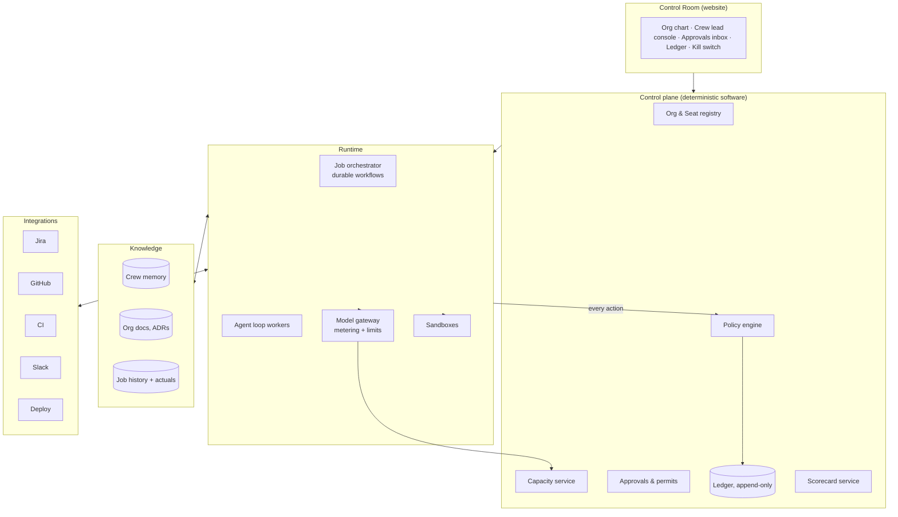
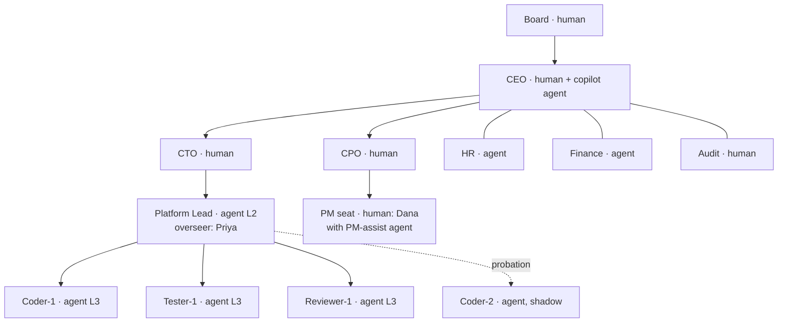
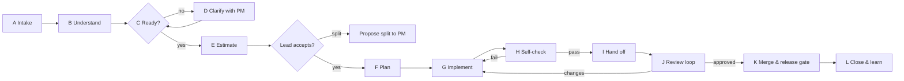
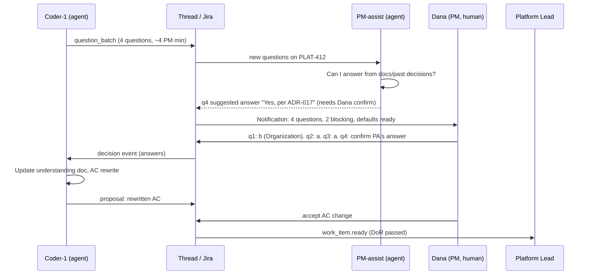
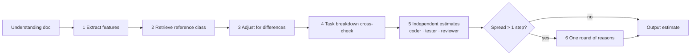
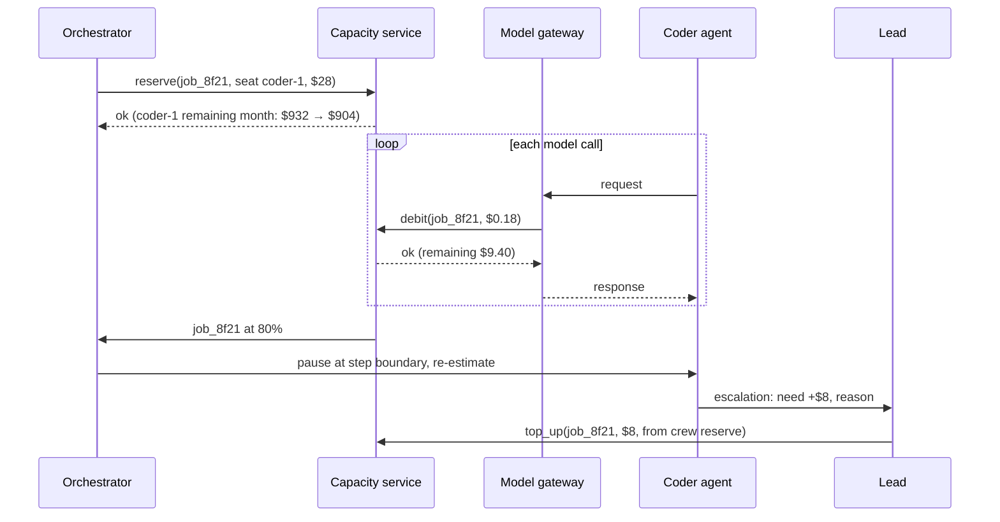
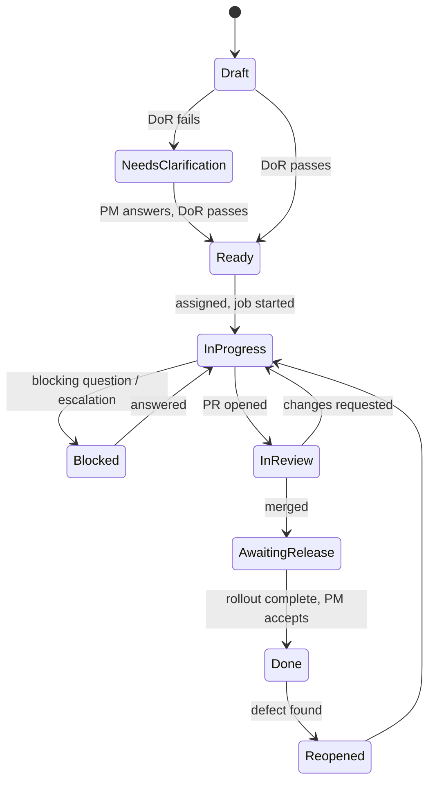
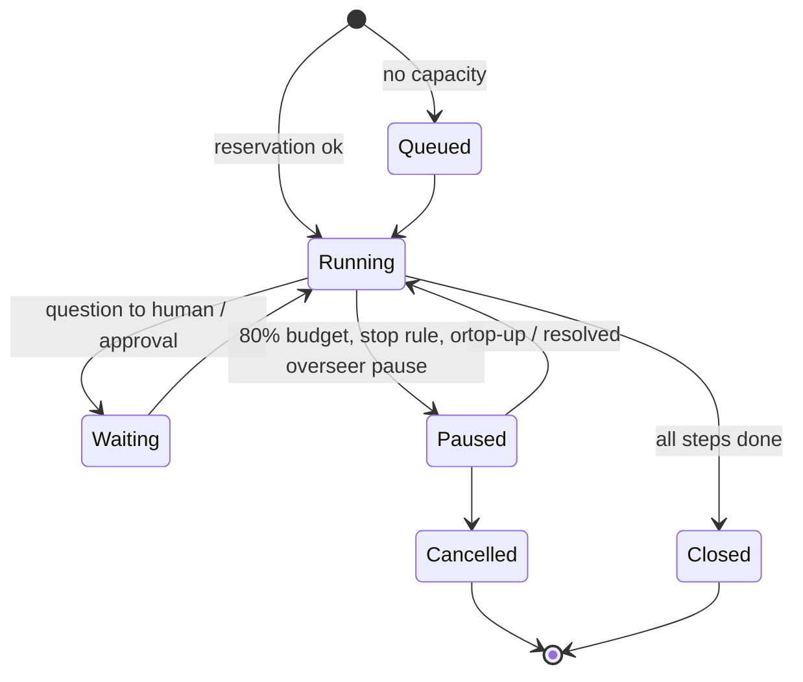
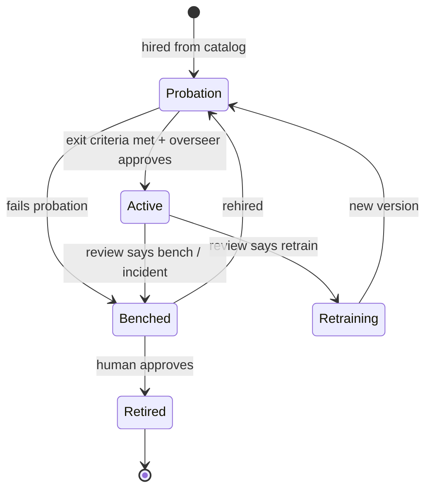

# Agent Org Model: Architecture Deep Dive

This document describes how the agent org model works inside. It follows one Jira ticket from the board's quarterly goal down to merged code, and shows at each level what the seat sees, decides, produces and hands on.

The short version of the concept is on the [live page](https://probita-ai.github.io/agent-org-model/) and in the [README](../README.md). This document covers the internals.

---

## Contents

1. [The big picture](#1-the-big-picture)
2. [Core objects](#2-core-objects)
3. [How work moves](#3-how-work-moves)
4. [The running example: PLAT-412 through every level](#4-the-running-example-plat-412-through-every-level)
5. [Estimation in depth](#5-estimation-in-depth)
6. [Conversations: how agents and humans talk](#6-conversations-how-agents-and-humans-talk)
7. [Context and memory](#7-context-and-memory)
8. [Capacity enforcement](#8-capacity-enforcement)
9. [Risk gates and permits](#9-risk-gates-and-permits)
10. [Scorecards, probation and benching](#10-scorecards-probation-and-benching)
11. [State machines](#11-state-machines)
12. [Failure modes and how the system handles them](#12-failure-modes-and-how-the-system-handles-them)
13. [Runtime components](#13-runtime-components)
14. [Build order](#14-build-order)
15. [Open questions](#15-open-questions)

---

## 1. The big picture

The system has five layers. Agents live only in the **runtime** layer. Everything that limits them lives in the **control plane**, which is plain software.



**Rules that shape everything below:**

| Rule | What it means in practice |
|---|---|
| Agents never call the outside world directly | Every tool call goes through the policy engine; every model call goes through the gateway. |
| Authority flows down only | A seat can grant at most what it holds. No seat can raise its own capacity, autonomy or permissions. |
| Every applied change has a before-state | Rollback is a ledger operation, not a request to an agent. |
| The kill switch is outside the runtime | Pausing revokes gateway keys and tool tokens. It does not ask the agent to stop. |
| Humans are a scarce resource | The system budgets human minutes the same way it budgets dollars. |

---

## 2. Core objects

These are the objects in the control plane. Every one of them is config, versioned, and changed only through the ledger.

| Object | What it is | Owned by |
|---|---|---|
| **Org unit** | A box in the tree: board, division, crew | Parent unit |
| **Seat** | A role inside a unit: authority, capacity share, reports, overseer | Unit leader |
| **Agent definition** | Model, prompt, skills, tools, version. Lives in the catalog. | Platform team |
| **Crew** | Template: which seats, which handoffs, which checklists | Crew lead |
| **Work item** | The thing to do. Mirrors a Jira issue. | PM seat |
| **Job** | One run of a crew on one work item. Has trace, cost, outputs. | Orchestrator |
| **Step** | One unit inside a job (understand, estimate, implement…) | Agent in a seat |
| **Brief** | Structured context packet passed between seats | Sender |
| **Thread** | A conversation tied to a work item (questions, decisions) | Work item |
| **Change set** | A proposed change with its before-state (code, config, seat change) | Author seat |
| **Checklist** | Required checks for a step (Definition of Ready, PR checklist…) | Crew lead |
| **Policy** | Rules about which actions need which approval | Policy seat (human) |
| **Permit** | A time-limited grant of a higher-risk action | Approver |
| **Scorecard** | Rolling metrics per agent per seat | HR service |
| **Lesson** | Something learned from a job, proposed into crew memory | Any seat; lead approves |
| **Ledger entry** | Who did what, when, with what approval and before-state | System |

### 2.1 Seat

```yaml
seat: coder-1
unit: platform-crew
role: coder
occupant: { type: agent, agent: coder-agent@v3.2 }
status: active                  # probation | active | benched | vacant
autonomy: L3                    # act and report
overseer: { user: priya, backup: sam }
reports_to: platform-lead
capacity:
  share_of_parent: 40%          # of platform-crew capacity
  monthly_usd: 960
  max_concurrent_jobs: 2
  human_minutes_per_week: 180   # review/clarify time it may consume from humans
permissions:
  repos: [platform-api, platform-workers]
  jira_projects: [PLAT]
  actions:
    allow: [repo.read, branch.write, pr.open, jira.comment, jira.estimate, ci.run]
    approve_first: [ci.config.write, db.migration.write]
    deny: [main.push, secrets.read, prod.deploy]
risk_ceiling: medium
```

### 2.2 Agent definition (catalog entry)

```yaml
agent: coder-agent
version: 3.2
model: { primary: claude-sonnet-5-5, escalation: claude-opus-5-5 }
skills: [repo-navigation, test-first-change, jira-hygiene, estimation]
tools: [git, ripgrep, test-runner, jira, github]
prompt_ref: prompts/coder/v3.2.md
limits:
  max_steps_per_job: 120
  max_retries_same_error: 3
fit_for_roles: [coder]
changelog: "v3.2: asks clarifying questions in one batch instead of drip-feeding"
```

### 2.3 Work item (mirrors Jira)

```yaml
work_item: PLAT-412
source: jira
type: story
title: Rate limit the public /export API
parent: PLAT-EPIC-40  "API reliability Q4"
status: ready_for_dev
acceptance_criteria:
  - Requests above the limit get HTTP 429 with Retry-After
  - Limits configurable per plan tier
  - Dashboard shows rejected request counts
estimate: null                  # filled by estimation step
risk_class: medium              # code change in a customer-facing API
assignee_seat: null
thread: thr_412
```

### 2.4 Job

```yaml
job: job_8f21
crew: platform-crew@v5
work_item: PLAT-412
state: running
current_step: implement
reservation: { usd: 28.00, human_minutes: 45 }   # P90 estimate, see §8
spent: { usd: 11.40, tokens: 2.1M, human_minutes: 12 }
steps:
  - { id: understand, seat: coder-1, state: done, cost: 1.10 }
  - { id: clarify,    seat: coder-1, state: done, waited_on: pm-1, wait: 3h10m }
  - { id: estimate,   seat: coder-1, state: done }
  - { id: plan,       seat: coder-1, state: done }
  - { id: implement,  seat: coder-1, state: running }
  - { id: test,       seat: tester-1, state: pending }
  - { id: review,     seat: reviewer-1, state: pending }
  - { id: release,    seat: platform-lead, state: pending, gate: human }
trace: traces/job_8f21
```

---

## 3. How work moves

Work moves through three kinds of objects, at three speeds:

| Object | Who creates it | Lifetime | Example |
|---|---|---|---|
| **Goal** | Board, CEO, executives | Quarter | "Cut API incidents by 50%" |
| **Work item** | PM seat, leads | Days to weeks | PLAT-412 |
| **Job** | Orchestrator, when a work item is assigned | Hours to days | job_8f21 |

Everything is event-driven. Seats do not poll; they react to events.

```text
goal.created  →  goal.allocated  →  epic.created  →  work_item.ready
→  work_item.assigned  →  job.started  →  step.completed (×N)
→  pr.merged  →  release.approved  →  job.closed  →  scorecard.updated
```

Each seat has a **cadence** (things it does on a schedule) and **triggers** (things it reacts to):

| Level | Cadence | Triggers |
|---|---|---|
| Board | Quarterly | Budget breach, incident above severity 1 |
| CEO | Monthly, weekly review | Division asks for more capacity |
| CTO | Weekly | Crew over budget, crew asks to hire |
| PM | Daily | Question on a thread, ticket blocked |
| Crew lead | Daily standup, sprint planning | Estimate submitted, job escalated, review due |
| Coder / tester / reviewer | None | Step assigned, comment received |
| HR | Weekly reviews, after every job | Override recorded, probation ended |
| Finance | Daily | Spend > 80% of any reservation or share |

---

## 4. The running example: PLAT-412 through every level

The org used in this example:



Each level below uses the same template:

- **Seat card**: who sits there, at what autonomy
- **Inputs**: what reaches this seat
- **Loop**: what the seat does
- **Decisions it owns**: what it can decide on its own
- **Outputs**: what it hands down or up
- **Escalates when**: when it must stop and ask
- **Measured by**: what goes on its scorecard

---

### 4.1 Board

| | |
|---|---|
| **Seat card** | Humans only. No agent seat at this level. |
| **Inputs** | Quarterly report from CEO: spend by division, outcomes vs goals, incidents, autonomy changes made. |
| **Loop** | Sets total capacity and the top-level goals. Approves any change to org-wide policy. |
| **Decisions it owns** | Total monthly capacity ($10,000), risk appetite (which actions are always "approve first"), who may sit in executive seats. |
| **Outputs** | `capacity.total = $10,000/month`, Goal G-Q4-2: "Cut customer-facing API incidents by 50%." |
| **Escalates when** | Never. This is the top. |
| **Measured by** | Not scored by the system. |

---

### 4.2 CEO

| | |
|---|---|
| **Seat card** | Human. A copilot agent at L2 drafts allocations and reports. |
| **Inputs** | Board goals, last quarter's spend vs outcome per division, division requests. |
| **Loop** | Copilot drafts a capacity split from last quarter's cost-per-outcome. CEO edits and approves. |
| **Decisions it owns** | Division shares. Engineering gets 40% ($4,000). |
| **Outputs** | Allocation change set, goal G-Q4-2 assigned to CTO. |
| **Escalates when** | A division asks for more than the CEO's reserve. Goes to board. |
| **Measured by** | Board review. Copilot is scored on how often the CEO edits its drafts. |

The copilot's draft is a change set:

```yaml
change_set: cs_ceo_q4_alloc
author: ceo-copilot@v1
proposes:
  engineering: 40%   # was 38%; +2% because G-Q4-2 needs platform work
  product: 20%
  support: 25%
  reserve: 15%
evidence: [report_q3_spend, goal_G-Q4-2]
before_state: { engineering: 38%, product: 20%, support: 25%, reserve: 17% }
needs_approval: ceo
```

---

### 4.3 CTO

| | |
|---|---|
| **Seat card** | Human. |
| **Inputs** | Goal G-Q4-2, $4,000/month, crew scorecards, incident data. |
| **Loop** | Turns the goal into epics, picks which crew owns each, splits capacity. |
| **Decisions it owns** | Platform crew gets 60% ($2,400). Creates epic PLAT-EPIC-40 "API reliability Q4". Sets Platform Lead's autonomy (L2). |
| **Outputs** | Epic with success metric ("export API 5xx < 0.1%"), capacity share, priority order across crews. |
| **Escalates when** | Engineering total would exceed $4,000. Goes to CEO. |
| **Measured by** | CEO review; epic outcomes. |

---

### 4.4 PM seat

The PM seat matters a lot in this example, because it is the coder's main partner.

| | |
|---|---|
| **Seat card** | Human (Dana) with a PM-assist agent at L2 that drafts tickets and pre-answers routine questions. |
| **Inputs** | Epic PLAT-EPIC-40, customer complaints (export API abused by scrapers), support tickets. |
| **Loop** | Writes stories with acceptance criteria, ranks the backlog, answers questions on threads, accepts finished work. |
| **Decisions it owns** | What "done" means (acceptance criteria), priority, scope cuts. |
| **Outputs** | PLAT-412 in `ready_for_dev`, with acceptance criteria. |
| **Escalates when** | Scope question changes the epic goal. Goes to CPO. |
| **Measured by** | Answer time on threads, how often accepted work is reopened, how often coders flag tickets as not ready. |

The PM-assist agent drafts the ticket from the customer data. Dana edits it. The draft is deliberately imperfect, which is realistic: it doesn't say whether the limit is per user or per org, or what the numbers are. The coder will find that.

**PM time is budgeted.** Dana's seat publishes `human_minutes_available: 300/week for platform crew`. Every question a coder asks draws from this budget (see §5 and §6).

---

### 4.5 Platform Lead

| | |
|---|---|
| **Seat card** | Agent `lead-agent@v2`, autonomy L2 (suggests; Priya approves). |
| **Inputs** | Ranked backlog from PM, crew capacity ($2,400), each member's scorecard and current load, estimates. |
| **Loop** | Grooming → sprint planning → assignment → daily standup → escalation handling → release gate. |
| **Decisions it owns (as proposals at L2)** | Who gets which ticket, capacity split among crew members, hire to probation, bench, top-ups from crew reserve. |
| **Outputs** | Assignments, sprint plan, capacity splits, hire/bench proposals. |
| **Escalates when** | Sprint P90 exceeds capacity; a member is over budget twice in a sprint; anything touching production. |
| **Measured by** | Sprint completion vs plan, crew cost per point, how often Priya rejects its proposals. |

#### Grooming

Twice a week the lead runs grooming on the top of the backlog:

1. For each candidate ticket, ask the likely coder for a **quick estimate** (cheap pass, read-only, capped at $0.50 per ticket).
2. Run the **Definition of Ready** check (§4.6, phase C). Tickets that fail go back to PM with the failing items listed.
3. Tickets above the split threshold (§5.6) get a split proposal sent to PM.

#### Sprint planning

The lead fills the sprint with tickets until the **P90 cost** reaches the crew's sprint capacity minus a 15% reserve. It uses P90, not P50, so that the sprint holds even when several tickets run long.

```text
Crew sprint capacity (2 weeks):      $1,200
Reserve (15%):                       $  180
Plannable:                           $1,020

Ticket      Points   P50 $   P90 $   Human min   Assignee
PLAT-412      5      $14     $28       45         coder-1
PLAT-415      3      $8      $15       20         coder-1
PLAT-418      8      $31     $62       90         coder-2 (shadow) + coder-1
...
Total P90:                           $ 980   ✓ under $1,020
Total human minutes (PM + Priya):    410     ✗ over 300 PM budget → drop PLAT-421
```

The last line matters: **sprints are often bounded by human minutes, not dollars.** The lead must fit both.

#### Assignment

The lead proposes assignments using a simple score per (ticket, coder) pair:

```text
fit = 0.4 × skill_match       (ticket modules vs agent's past success there)
    + 0.3 × calibration       (how accurate this agent's estimates are)
    + 0.2 × availability      (free job slots, remaining capacity)
    − 0.1 × risk_mismatch     (ticket risk above seat's risk ceiling → excluded)
```

At L2, Priya sees "PLAT-412 → coder-1 (fit 0.82), runner-up coder-2 (0.61, on probation)" and clicks approve. At L3 the lead would assign and Priya would see it in the digest.

The **probation agent** coder-2 gets a shadow copy: it runs the same job in a separate sandbox, its outputs are compared to coder-1's, and nothing it produces leaves the sandbox.

---

### 4.6 Coder (the deep one)

| | |
|---|---|
| **Seat card** | Agent `coder-agent@v3.2`, autonomy L3, overseer Priya, $960/month, 2 concurrent jobs. |
| **Inputs** | Assignment event + brief from lead; the Jira ticket; the repo; crew memory; the thread with PM. |
| **Decisions it owns** | How to implement, how to split into commits, which tests to write, its own estimate. |
| **Escalates when** | Acceptance criteria are ambiguous; estimate exceeds threshold; same error 3 times; spend > 80% of reservation; any action in `approve_first`. |
| **Measured by** | First-pass review approval, tests passing, reopen rate, estimate calibration, cost per point, human minutes consumed, override count. |

The coder works through twelve phases. Each phase is a **step** in the job, so it has its own trace, cost and outputs, and the job can resume from any of them.



#### Phase A — Intake

Triggered by `work_item.assigned`.

1. The orchestrator creates `job_8f21` and asks the capacity service for an **initial reservation** (the grooming quick-estimate P90, here $20). If the seat has no room, the job queues and the lead is told.
2. The coder receives a **brief** from the lead:

```yaml
brief: br_412_lead_to_coder
from: platform-lead
to: coder-1
work_item: PLAT-412
why_it_matters: "Part of PLAT-EPIC-40. Scrapers caused 3 export API incidents in October."
constraints:
  - "Use the existing Redis cluster; no new infra this sprint."
  - "Do not change the public response schema for non-429 responses."
known_context:
  - "ADR-017 chose token bucket for internal APIs."
  - "Plan tiers live in billing-service, read via /v1/plans."
deadline: sprint-23 end
budget_reservation_usd: 20     # will be replaced after estimate
human_contacts: { pm: dana, overseer: priya }
```

Note the brief is **not** "here's the ticket, good luck." Each level adds what it knows (§7.2).

#### Phase B — Understand

Read-only. Capped at $3.

The coder builds an **understanding doc**. This is the most important artifact in the job, because every later step and every reviewer reads it.

```yaml
understanding: und_412
restated_goal: >
  Stop any single caller from overloading /export by limiting request rate,
  with limits that differ by plan tier, and make rejections visible.
acceptance_criteria_mapped:
  - ac: "Requests above the limit get HTTP 429 with Retry-After"
    test_plan: "integration test: burst N+1 requests, assert 429 and header"
    status: clear
  - ac: "Limits configurable per plan tier"
    test_plan: "unit test on limit lookup per tier"
    status: AMBIGUOUS     # per user? per org? per API key?
  - ac: "Dashboard shows rejected request counts"
    test_plan: "metric emitted; dashboard is separate?"
    status: AMBIGUOUS     # build the dashboard or just emit the metric?
code_map:
  entry: platform-api/src/routes/export.ts
  middleware_dir: platform-api/src/middleware/
  existing_pattern: platform-api/src/middleware/internalRateLimit.ts  # ADR-017
  tests: platform-api/test/routes/export.test.ts  (coverage 71%)
blast_radius:
  services: [platform-api]
  callers_affected: "all external export clients"
  data_migration: none
unknowns:
  - Limit numbers per tier
  - Limit key (user, org, API key)
  - Behaviour for internal callers (bypass?)
assumptions_if_unanswered:
  - "Key = API key, since export auth is by API key"
  - "Internal service tokens bypass the limit"
risk_class_check: medium (confirms ticket)
```

How it gets there:

1. Parse the ticket, epic and linked docs.
2. Search crew memory for lessons tagged `rate-limit`, `export`, `platform-api`.
3. Explore the repo (ripgrep, read files, read git log for `export.ts`).
4. Map each acceptance criterion to a concrete test. **An AC that can't be mapped to a test is marked ambiguous.** This one rule catches most unclear tickets.
5. List unknowns, and for each one, the assumption it would make if nobody answers.

#### Phase C — Definition of Ready

A checklist owned by the crew lead. Deterministic where possible, model-judged where not.

| Check | How it's checked | PLAT-412 |
|---|---|---|
| Every AC maps to a test | From understanding doc | ✗ 2 ambiguous |
| No open unknown blocks the design | Unknowns marked `blocking` | ✗ limit key blocks design |
| Dependencies are available | Links resolved, services reachable | ✓ |
| Fits under split threshold | Quick estimate | ✓ |
| Risk class matches seat ceiling | Policy lookup | ✓ medium ≤ medium |

Fails → go to phase D. If only non-blocking items fail, the coder may proceed with written assumptions and clarify in parallel.

#### Phase D — Clarify with PM

This is the "discuss with PM" part. The rules:

1. **One batch, not a drip.** All questions go in one message. (This was the v3.2 change in the agent changelog; v3.1 asked one at a time and wasted PM time.)
2. **Every question has options and a default.** PM can answer with one click.
3. **Each question is tagged blocking or non-blocking.**
4. **Each question carries its cost.** The coder estimates how long it will take PM to answer, and this is drawn from the human-minute budget.

The message, posted on the thread and mirrored as a Jira comment:

```yaml
message: msg_412_q1
type: question_batch
from: coder-1
to: pm-1 (dana)
work_item: PLAT-412
estimated_pm_minutes: 4
questions:
  - id: q1
    blocking: true
    text: "What should the limit be keyed on?"
    options:
      a: "API key (matches how /export authenticates)"   # default
      b: "Organization (all keys in an org share one limit)"
      c: "User"
    why: "Changes the Redis key design and what customers see when one key is noisy."
  - id: q2
    blocking: true
    text: "Limits per tier?"
    options:
      a: "Free 10/min, Pro 60/min, Enterprise 600/min"   # default, from billing docs
      b: "Something else (please give numbers)"
  - id: q3
    blocking: false
    text: "'Dashboard shows rejected counts': build a dashboard, or emit a metric that ops adds to the existing dashboard?"
    options:
      a: "Emit metric only; ops owns dashboards"          # default
      b: "Build the dashboard panel in this ticket (+2 points)"
  - id: q4
    blocking: false
    text: "Should internal service tokens bypass the limit?"
    options: { a: "Yes (default)", b: "No" }
if_no_answer_by: "+1 business day → proceed with defaults, mark assumptions on ticket"
```

The sequence:



Points worth noting:

- **Dana picked a non-default answer (org, not API key).** That's the reason to ask rather than assume. The coder records it as a decision, with Dana as the decider, so a reviewer later doesn't "fix" it back.
- **The coder can propose AC wording but cannot change AC.** Only the PM seat can accept it. This is enforced by permissions: `jira.ac.write` is not in the coder's allow list.
- **PM-assist pre-answered q4** from ADR-017, but a human confirmed it. At L3 it could answer routine questions directly.
- **Timeout path:** If Dana doesn't answer, after one business day the coder proceeds on the defaults for non-blocking items and pings the lead about the blocking ones. The lead can answer, re-prioritise, or escalate to Dana's backup.

Actual PM minutes used: 3. This is recorded against both the coder's and the PM seat's human-minute budget, and feeds the coder's "human minutes per point" metric.

#### Phase E — Estimate

Fully described in §5. Summary of what the coder posts to Jira:

```yaml
estimate: est_412
points: 5
confidence: medium
agent_cost_usd: { p50: 14, p90: 28 }
wall_clock_hours: { p50: 6, p90: 14 }    # includes review and CI waits
human_minutes: { pm: 5, reviewer_human_sample: 15, overseer: 10, total_p90: 45 }
tasks:
  - "Org-keyed token bucket middleware (reuse internalRateLimit pattern)"   2
  - "Tier lookup with cache from billing-service"                           1
  - "429 + Retry-After + metric emission"                                   1
  - "Tests: unit + integration burst test"                                  1
reference_class: [PLAT-301 (5pt, $12), PLAT-288 (3pt, $9), PLAT-350 (8pt, $33)]
risks:
  - "billing-service /v1/plans has no cache; may need one (+1 pt if so)"
split_needed: false
```

The lead checks it against grooming's quick estimate (3 points then; 5 now because of the org-key decision). The gap is explained by the PM's answer, so the lead accepts and the reservation is updated from $20 to $28.

#### Phase F — Plan

For medium-risk work, the coder writes a short plan and the **reviewer agent reviews the plan before any code is written.** This costs about $0.40 and catches wrong approaches before they cost $15.

```yaml
plan: plan_412
approach: "Express middleware using Redis token bucket, key = org_id, limit from tier cache"
files:
  add:    [src/middleware/exportRateLimit.ts, test/middleware/exportRateLimit.test.ts]
  modify: [src/routes/export.ts, src/metrics.ts, config/default.yaml]
not_touching: [response schema, billing-service]
rollout: "Behind flag export_rate_limit, default off; turn on per tier"
rollback: "Flip flag off. No data migration."
open_risk: "tier lookup latency; cache 60s"
```

Reviewer-1 replies `approve_plan` with one note: "use the existing `RedisClient` wrapper, not a new connection." The coder adds it.

#### Phase G — Implement

Runs in a sandbox: a fresh container with the repo checked out on branch `plat-412-export-rate-limit`, test database, no production credentials, network limited to package registries and the test Redis.

The inner loop:

```text
repeat:
  pick next task from plan
  write test first (where the AC maps to a test)
  write code
  run focused tests
  if pass: commit with message referencing PLAT-412, checkpoint
  if fail: diagnose, fix
     if same failure signature 3 times: escalate (stop rule)
  check meter: if spend > 80% of reservation → pause, re-estimate, ask lead
until all tasks done
```

**Checkpoints** are saved after every passing commit, so a paused or crashed job resumes from the last good state rather than starting over.

**Stop rules** (hard, enforced by the orchestrator, not the prompt):

| Rule | Trigger | Action |
|---|---|---|
| Same-error loop | 3 identical failure signatures | Escalate to lead with the trace |
| Budget | 80% of reservation | Pause; agent must re-estimate; lead tops up or stops |
| Scope creep | Diff touches files not in plan | Flag in self-check; reviewer must accept |
| Step count | > 120 steps | Pause and escalate |
| Model escalation | Primary model failed twice on a subtask | Retry that subtask on the escalation model, logged |

For PLAT-412 the coder discovered the risk it flagged: billing-service has no cache. It added a 60-second in-process cache (already in the plan's "open risk"), so no re-estimate was needed.

#### Phase H — Self-check

The PR checklist, mostly deterministic:

| Check | Type |
|---|---|
| All tests pass, coverage of changed lines ≥ 80% | CI |
| Lint and type check clean | CI |
| Every AC has a passing test linked | Understanding doc vs test names |
| Diff only touches planned files (or explains why) | Diff vs plan |
| No secrets, no new dependencies without note | Scanner |
| Feature flag present for customer-facing change | Policy rule for medium risk |
| Decisions from thread reflected (org key, not API key) | Model check against thread |

#### Phase I — Hand off

The coder opens the PR (`pr.open` is allowed) and sends **two briefs**: one to the tester and one to the reviewer. The PR description is generated from the understanding doc, plan and decisions, so the reviewer sees *why* as well as *what*.

```yaml
brief: br_412_coder_to_reviewer
pr: platform-api#1187
summary: "Org-keyed token bucket on /export, limits by tier, 429 + Retry-After, metric."
decisions_to_respect:
  - "Keyed by org, decided by Dana (PM) on thread msg_412_q1. Not a bug."
deviations_from_plan: none
where_to_look_hardest:
  - "Tier cache invalidation (src/middleware/exportRateLimit.ts:40-72)"
self_check: all passed
cost_so_far_usd: 12.10
```

#### Phase J — Review loop

Covered in §4.7 and §4.8. The coder gets comments as events, fixes, and pushes. **Max 3 review rounds**; a 4th round escalates to the lead, because it usually means the plan was wrong or the reviewer and coder disagree.

#### Phase K — Merge and release gate

- Merge to main: allowed when CI is green and reviewer approved (medium risk, policy auto-merges).
- Turning on the flag in production: **high risk**, so a human approves first (§9). The lead prepares the request; Priya approves.

#### Phase L — Close and learn

1. Actuals recorded: $13.20, 7.5 hours wall clock, 31 human minutes, 2 review rounds.
2. Estimate vs actual feeds the coder's calibration score (§5.7).
3. Reservation released: $28 − $13.20 = $14.80 returns to the crew pool.
4. The coder proposes a **lesson**:

```yaml
lesson: les_0931
from_job: job_8f21
text: "billing-service /v1/plans has no cache; anything calling it per request needs one. A 60s in-process cache is enough."
tags: [billing-service, performance, rate-limit]
proposed_by: coder-1
status: pending_lead_approval
```

The lead approves it into crew memory. The next coder that touches billing-service gets it in phase B.

---

### 4.7 Tester

| | |
|---|---|
| **Seat card** | Agent `tester-agent@v1.4`, L3. |
| **Inputs** | PR, brief from coder, AC list. |
| **Loop** | Read AC → design adversarial tests the coder didn't write → run them → report. |
| **Decisions it owns** | Pass/fail on functional behaviour. Which extra tests to add. |
| **Outputs** | Test report; extra tests committed to the branch (`branch.write` allowed on PR branches only). |
| **Escalates when** | AC can't be tested as written → goes to PM, not coder. |
| **Measured by** | Bugs caught before merge vs bugs found after; false-failure rate. |

For PLAT-412 the tester added: limit resets correctly after the window; two orgs don't share buckets; Redis outage behaviour (fails open or closed?). That last one is a **new question**, so it goes to the thread:

```yaml
message: msg_412_q5
type: question
from: tester-1
to: pm-1
blocking: true
text: "If Redis is down, should /export allow all requests (fail open) or reject (fail closed)?"
options: { a: "Fail open, alert ops (default)", b: "Fail closed" }
```

Dana picks a. The coder adds the behaviour and a test. One extra review round.

---

### 4.8 Reviewer

| | |
|---|---|
| **Seat card** | Agent `reviewer-agent@v2.0`, L3. A human (Sam) reviews a 10% sample, since code changes are medium risk. |
| **Inputs** | PR, coder's brief, plan, thread decisions. |
| **Loop** | Check against plan, decisions and crew conventions; comment; approve or request changes. |
| **Decisions it owns** | Approve, request changes. |
| **Escalates when** | Disagreement with coder after 2 rounds; anything that looks like a security issue. |
| **Measured by** | Escaped defects on PRs it approved; human-sample disagreement rate; comments the coder marked "not useful". |

**Human sampling**: PLAT-412 was picked for Sam's sample. Sam agrees with the approval. If Sam had disagreed, it would count as an override against the reviewer agent's scorecard.

**Coder–reviewer disagreements** follow a fixed protocol (§6.4), not free-form debate.

---

### 4.9 Release

| | |
|---|---|
| **Seat card** | Platform Lead prepares; Priya (human) approves. |
| **Inputs** | Merged PR, flag `export_rate_limit`, test report, rollback plan. |
| **Loop** | Lead proposes staged rollout; human approves each stage. |
| **Outputs** | Rollout change set with before-state (flag off). |

```yaml
change_set: cs_412_rollout
risk: high              # production behaviour change for customers
stages:
  - { flag: on, tiers: [free], watch: 24h, abort_if: "export 5xx > 0.2% or 429 rate > 5%" }
  - { flag: on, tiers: [free, pro], watch: 24h }
  - { flag: on, tiers: all }
before_state: { export_rate_limit: off }
approver: priya
rollback: one click → before_state
```

A watcher agent monitors the abort conditions. If one trips, the **platform** flips the flag back (plain software); the agent only raises the alarm.

---

### 4.10 After the job: HR, Finance, Audit

**HR agent** (runs after every job and weekly):

```yaml
job_signals: job_8f21
coder-1:
  first_pass_review: false        # needed changes (fail-open behaviour)
  review_rounds: 2
  tests_passed_first_ci: true
  estimate_error: -0.53           # actual $13.20 vs P50 $14 → slightly under
  within_p90: true
  human_minutes: 31 (est 45)
  overrides: 0
  reopened_within_14d: pending
coder-2 (shadow):
  same_job_shadow_result: "diverged on key design (chose API key, ignored thread decision)"
  shadow_score: 0.58
```

**Finance agent**: crew spent $412 of $1,200 this sprint; no seat above 80%. Daily report to lead and CTO.

**Audit (human)**: can query the ledger for PLAT-412 and see every decision, who made it, who approved it, and the before-state of every change.

---

## 5. Estimation in depth

### 5.1 What an estimate must contain

A human team estimates in story points. Agent work needs more than that, because the scarce resources are different.

| Field | Why it exists |
|---|---|
| **Points** (Fibonacci, team-relative) | Keeps one scale for humans and agents; PMs and leads already think in it. |
| **Agent cost** P50 / P90 ($) | Drives the capacity reservation. |
| **Wall clock** P50 / P90 | Includes waits on humans and CI, which usually dominate. |
| **Human minutes** (PM, reviewer, overseer) | Often the real bottleneck. |
| **Confidence** (low / medium / high) | How wide the P50–P90 gap is allowed to be. |
| **Task breakdown** | Makes the estimate inspectable. |
| **Reference class** | Which past jobs it was compared to. |
| **Risks** | Things that would move the estimate, and by how much. |

### 5.2 Three passes

| Pass | When | Cost cap | Accuracy goal |
|---|---|---|---|
| **Quick** | Grooming | $0.50 | Right Fibonacci bucket ±1 |
| **Full** | Phase E, after clarification | $2 | P90 holds 90% of the time |
| **Re-estimate** | Spend hits 80% of reservation, or scope changed | $1 | Explains the gap |

### 5.3 The method



**Step 1 — Extract features** (mostly deterministic, from the understanding doc and repo):

| Feature | PLAT-412 |
|---|---|
| Files likely touched | 5 |
| Services touched | 1 |
| Existing pattern to copy | yes (ADR-017 middleware) |
| Test coverage of touched area | 71% |
| New dependency | no |
| Data migration | no |
| External service calls | 1 (billing-service) |
| AC count / ambiguous after clarification | 3 / 0 |
| Risk class | medium |
| Customer-facing | yes |

**Step 2 — Retrieve reference class.** Search closed jobs by feature similarity and text similarity. Take the 5 nearest with actuals.

| Past job | Points | Actual $ | Wall clock | Human min | Similarity |
|---|---|---|---|---|---|
| PLAT-301 internal rate limit | 5 | $12.40 | 5h | 30 | 0.88 |
| PLAT-288 add 429 to search | 3 | $8.90 | 4h | 20 | 0.81 |
| PLAT-350 per-tier quotas | 8 | $33.00 | 16h | 80 | 0.74 |
| PLAT-266 export pagination | 3 | $7.10 | 3h | 15 | 0.62 |
| PLAT-310 metrics for jobs | 2 | $5.00 | 2h | 10 | 0.55 |

**Step 3 — Adjust.** Start from the similarity-weighted median, then apply named adjustments. Every adjustment must be written down, which makes estimates reviewable.

```text
base P50 (weighted median of reference class)     $12.00
+ external service call without cache             × 1.15
+ customer-facing (flag + rollout plan needed)    × 1.05
P50                                               ≈ $14.00
P90 = P50 × spread factor (medium confidence 2.0)   $28.00
```

Spread factors come from the agent's own history: if its actual/P50 ratios over the last 30 jobs have a 90th percentile of 2.0, the spread factor is 2.0. A well-calibrated agent earns narrower ranges.

**Step 4 — Task breakdown cross-check.** Sum the tasks' points independently. If the bottom-up sum differs from the reference-class bucket by more than one Fibonacci step, the coder must explain which one is wrong.

**Step 5 — Independent estimates.** Coder, tester and reviewer each estimate *without seeing the others*. This is agent planning poker. It costs about $0.30 more and catches the case where one agent misread the ticket.

```text
coder 5 · tester 5 · reviewer 8
```

**Step 6 — One round of reasons.** Spread is 1 step (5 vs 8), at the threshold, so each gives one reason:

- Reviewer: "Tier lookup could need a cache in billing-service, which is another service."
- Coder: "An in-process cache in platform-api is enough; no change to billing-service."

The reviewer accepts. Final 5, with the risk noted. **There is exactly one round.** If they still disagree, the lead picks and records why. Unbounded agent debate is a cost sink.

### 5.4 Human minutes

Human minutes are estimated separately, because they are what humans actually notice:

```text
PM:        questions already asked (3 min) + acceptance (2 min)          =  5
Reviewer:  10% sample chance × 30 min review → but budget P90 as if sampled = 15
Overseer:  release approval (high risk) 10 min × 1                         = 10
Tester Q:  expected new questions (from history: 0.6 per ticket × 5 min)   =  3
Buffer                                                                     = 12
P90 total                                                                  = 45
```

### 5.5 Points for agents vs humans

Keep **one point scale** across humans and agents; it's relative complexity, not time. Track **velocity separately** per seat type:

| Seat | Points per sprint | Cost per point | Human min per point |
|---|---|---|---|
| Human coder (reference) | 13 | ~$1,150 (salary share) | 8 |
| coder-1 (agent) | 34 | $2.70 | 6 |
| coder-2 (probation) | — (shadow) | $3.40 | — |

The useful number for a lead is not "agents are faster." It's **human minutes per point**, because that's what limits how many agent jobs the humans can supervise.

### 5.6 Split rules

The coder **must** propose a split when any of these hold:

- Points > 8
- P90 cost > $40, or P90 wall clock > 3 days
- Touches more than 2 services
- Contains both a schema migration and a behaviour change
- Confidence is low *and* points ≥ 5

A split proposal is a change set to the PM: new child tickets, each with its own AC. The PM accepts, edits or rejects.

### 5.7 Calibration (how estimates get better)

After every job:

```text
ratio        = actual_cost / P50
within_p90   = actual_cost ≤ P90
point_error  = |actual_points_by_reviewer − estimated_points|
```

Rolling over the last 30 jobs, HR computes:

| Metric | Target | coder-1 |
|---|---|---|
| Median ratio | 0.9–1.1 | 0.96 |
| P90 hit rate | ≥ 88% | 91% |
| Point error ≥ 2 steps | ≤ 10% | 6% |

**Calibration is part of the scorecard.** An agent that always says "13 points, P90 $200" would be safe but useless; one that always says "2 points" would blow budgets. Both lose score. The lead also uses calibration to set each agent's spread factor and reservation size.

---

## 6. Conversations: how agents and humans talk

### 6.1 Every conversation is attached to something

There is no free-floating chat. Every message belongs to a **thread**, and every thread belongs to a work item, job, change set or seat. This keeps context findable and auditable.

### 6.2 Message types

| Type | Use | Requires response? |
|---|---|---|
| `status` | Progress note | No |
| `question` / `question_batch` | Needs an answer to proceed | Yes, with SLA |
| `proposal` | Suggests a change (AC wording, split, plan) | Accept / edit / reject |
| `decision` | Records a decision and who made it | No; becomes binding context |
| `objection` | Disagrees with a proposal or decision, with reason | Yes, by decision owner |
| `handoff` | Passes work with a brief | Acknowledge |
| `escalation` | "I can't proceed; here's why and what I need" | Yes, by the seat above |

### 6.3 Who decides what

Every question type has a **decision owner**, set in crew config. Agents route questions to the owner, not to whoever is nearest.

| Question about | Decision owner |
|---|---|
| What the product should do (AC, scope, behaviour) | PM seat |
| How to build it | Coder (within plan), reviewer can object |
| Whether the build is good enough | Reviewer |
| Whether it works | Tester |
| Priority, assignment, capacity | Crew lead |
| Production change | Overseer (human) |
| Policy | Policy seat (human) |

The tester's fail-open question went to the PM, not the coder, because it's about product behaviour.

### 6.4 Disagreement protocol

1. Party A posts `objection` with a reason and a proposed alternative.
2. Party B responds once, with a reason.
3. If not resolved, the **decision owner** decides. If the decision owner is one of the parties, it goes to the lead.
4. The decision is recorded. The losing party does not reopen it in the same job.

Max 2 agent messages before a decision. This makes agent arguments cheap and finite.

### 6.5 SLAs and timeouts

| Message to | SLA | On timeout |
|---|---|---|
| Agent seat | 10 min | Orchestrator retries; then lead is told |
| Human, blocking | 4 business hours | Ping backup; lead notified |
| Human, non-blocking | 1 business day | Proceed on stated default, mark as assumption |

### 6.6 Talking to humans well

The point of these rules is to spend human attention carefully:

- Batch questions.
- Always offer options and a default.
- Say why the answer matters.
- Say how long it should take to answer.
- Never ask what's already answered in docs or crew memory (PM-assist checks first).
- Agents are scored on **human minutes consumed per point**, so asking lazy questions has a cost.

---

## 7. Context and memory

### 7.1 Four tiers

| Tier | Contents | Lifetime | Who writes |
|---|---|---|---|
| **Job scratch** | Exploration notes, intermediate files, sandbox state | Dies with job (trace kept) | Agent in job |
| **Work item** | Understanding doc, thread, decisions, estimate, plan | Life of ticket + archive | Seats in the job |
| **Crew memory** | Conventions, lessons, gotchas, reference classes | Until retired by lead | Lead approves lessons |
| **Org knowledge** | ADRs, docs, policies, goals | Versioned | Humans, or agents via change set |

An agent's **own history** (scorecard, past jobs) is attached to the agent, not the seat, so it follows the agent if it's moved or rehired.

### 7.2 Briefs fight context loss

The biggest weakness of deep agent hierarchies is that context degrades at every handoff. Briefs are the counter-measure:

- **Each level adds; it never just forwards.** The CTO adds the epic's metric. The PM adds the customer story. The lead adds constraints and known context. The coder adds decisions and where to look hardest.
- **Briefs are structured.** Fixed fields (`why_it_matters`, `constraints`, `decisions_to_respect`, `known_context`) so the receiver can check nothing is missing.
- **Briefs link, they don't paste.** They point to the understanding doc, thread and ADRs instead of summarising them, so the receiver can go to the source.
- **Decisions are binding context.** Anything recorded as a `decision` is injected into every later step's context for that work item.

### 7.3 What goes into the coder's context window at phase G

```text
system: agent prompt v3.2 + seat permissions summary
brief: br_412_lead_to_coder
understanding doc: und_412
decisions: [org key (Dana), tier limits (Dana), metric only (Dana), internal bypass (Dana)]
plan: plan_412 + reviewer note
crew memory hits: 3 lessons (rate-limit, platform-api conventions)
current task + last checkpoint diff
```

Not included: the whole ticket history, the PM's raw Slack messages, other jobs. Retrieval adds more only when the agent asks.

---

## 8. Capacity enforcement

### 8.1 The tree of shares

```text
Board $10,000
└─ Engineering 40%  $4,000
   └─ Platform crew 60%  $2,400
      ├─ coder-1 40%  $960
      ├─ tester-1 15% $360
      ├─ reviewer-1 15% $360
      ├─ lead-agent 10% $240
      ├─ coder-2 (probation) 0% → shadow budget from crew reserve, capped $100
      └─ reserve 20%  $480
```

### 8.2 Reservations

Spend is controlled per **job**, not just per month:

1. On assignment: reserve the quick-estimate P90 from the seat's monthly share.
2. After full estimate: adjust the reservation to the full P90.
3. Every model call goes through the gateway, which decrements the job's remaining reservation.
4. At 80%: the agent is paused at the next step boundary and must re-estimate.
5. At 100%: the gateway rejects further calls. Hard stop. The lead may top up from the **crew reserve**, within its own authority; beyond that it goes to the CTO.
6. On close: unused reservation returns to the seat's share.



### 8.3 Other capacity types

The same mechanism applies to:

- **Concurrent job slots** (coder-1 has 2).
- **Human minutes** (each human seat publishes weekly availability; jobs reserve from it).
- **Tokens per minute** (to protect shared rate limits at the provider).

---

## 9. Risk gates and permits

### 9.1 Every action has a risk class

The policy engine classifies each **tool call**, not each agent:

| Action | Risk | Default gate |
|---|---|---|
| `repo.read`, `jira.read`, `memory.read` | Low | Allowed, logged |
| `branch.write`, `jira.comment`, `ci.run` | Low | Allowed, logged |
| `pr.open`, `jira.estimate` | Medium | Allowed, 10% sampled |
| `pr.merge` (CI green + approved) | Medium | Allowed, sampled |
| `ci.config.write`, `db.migration.write` | High | Approve first |
| `prod.flag.change`, `prod.deploy` | High | Approve first, staged |
| `secrets.read`, `main.push`, `policy.write` | Blocked | Never for agents |

A seat's autonomy level and risk ceiling decide whether an action runs, waits for approval, or is refused.

### 9.2 Permits

When an agent needs a high-risk action routinely (e.g. a migration ticket), a human grants a **permit** instead of approving each call:

```yaml
permit: pmt_77
grants: db.migration.write
to: coder-1
scope: { repo: platform-api, work_item: PLAT-430 }
expires: 2026-11-22
granted_by: priya
```

Permits are narrow (one work item), time-limited, and revocable in one click.

### 9.3 Oversight sampling

| Risk | Sampling |
|---|---|
| Low | Daily digest, 2% of steps sampled for human review |
| Medium | Alerts on anomalies, 10% sampled, rollback ready |
| High | Human approval before execution |

Sampled items that a human disagrees with become **overrides**, which count against the agent's scorecard.

---

## 10. Scorecards, probation and benching

### 10.1 Coder scorecard

| Signal | Source | Weight |
|---|---|---|
| First-pass review approval | Reviewer | 15% |
| CI green on first push | CI | 10% |
| Escaped defects (bugs within 14 days) | Jira links | 20% |
| Estimate calibration (§5.7) | Actuals | 15% |
| Cost per point | Gateway | 10% |
| Human minutes per point | Threads, approvals | 15% |
| Overrides by humans | Ledger | 15% |

Scores are computed over a rolling window (last 30 jobs or 4 weeks). Signals from **real outcomes** (CI, escaped defects, overrides) outweigh signals from **other models' judgment** (reviewer opinions), because the latter can be wrong in correlated ways.

### 10.2 Probation in shadow mode

coder-2 runs the same jobs as coder-1 in a separate sandbox. Nothing it does leaves the sandbox. It's compared on:

| Comparison | How |
|---|---|
| Did its tests pass? | Run its branch through CI in isolation |
| Did it respect thread decisions? | Check diff against recorded decisions |
| Estimate accuracy | Same as active agents |
| Reviewer verdict | Reviewer agent reviews it blind (doesn't know which is shadow) |
| Cost | Gateway |

**Exit criteria** (set by the lead, approved by overseer): at least 10 shadow jobs, shadow score ≥ 0.75, zero decision violations in the last 5. coder-2 is at 0.58 and ignored a PM decision on PLAT-412, so probation continues.

### 10.3 Review outcomes

| Outcome | Trigger | Effect |
|---|---|---|
| Promote | Score ≥ 0.85 for 2 windows | More capacity, or autonomy +1 (overseer approves) |
| Keep | 0.7 – 0.85 | No change |
| Retrain | 0.55 – 0.7, or one specific failure pattern | New prompt/skills/model version → back to probation |
| Bench | < 0.55, or repeated policy violations | Capacity 0, access revoked, history kept |
| Retire | Benched > 90 days and replaced | Human must approve |

### 10.4 Autonomy changes

Moving a seat from L2 to L3 needs:

- 4 weeks at L2 with the overseer accepting ≥ 95% of proposals unchanged
- No high-severity override in that period
- Overseer approval (the seat cannot request its own promotion; HR proposes it)

Moving down is immediate and can be done by the overseer or triggered automatically by an incident.

---

## 11. State machines

### 11.1 Work item (mirrors Jira)



### 11.2 Job



### 11.3 Seat occupant



---

## 12. Failure modes and how the system handles them

| Failure | Detection | Response |
|---|---|---|
| Coder misreads ticket | AC→test mapping fails; planning poker spread; reviewer plan review | Caught before code, cheap |
| Agent loops on the same error | Same failure signature ×3 | Hard stop, escalate with trace |
| Cost runaway | Gateway meter | 80% pause, 100% hard stop |
| Agent ignores a PM decision | Self-check and reviewer compare diff to decisions | Request changes; counts against score |
| PM never answers | SLA timer | Backup pinged; non-blocking proceeds on defaults |
| Coder and reviewer argue | Round counter | Decision owner or lead decides after 2 messages |
| Bad change reaches production | Watcher abort conditions | Platform reverts to before-state; incident opened |
| Reviewer agent rubber-stamps | Human sample disagreement rate rises | Reviewer scored down; sampling raised to 30% |
| Correlated model errors (coder and reviewer share blind spot) | Escaped defect rate | Use a different model or vendor for reviewer seat; human sample |
| Context lost in handoff | Receiver's brief check finds missing fields | Handoff rejected back to sender |
| Agent tries to raise own budget or permissions | Policy engine | Refused, logged, alert to overseer |
| Kill switch needed | Human clicks pause | Gateway keys and tool tokens revoked within seconds, independent of agent |

---

## 13. Runtime components

The platform is ordinary services. Language is undecided (Python or TypeScript); nothing below depends on it.

| Component | Responsibility | Notes |
|---|---|---|
| **Control Room** (web) | Org chart, consoles, approvals inbox, ledger viewer, kill switch | The existing concept page is the mockup |
| **Org & seat registry** | Seats, units, occupants, autonomy | Postgres; every change via ledger |
| **Capacity service** | Shares, reservations, debits, top-ups | Must be strongly consistent; single writer per seat |
| **Policy engine** | Classifies and allows/gates/refuses every tool call | Rules as data (OPA-style); no LLM in the decision path |
| **Approvals & permits** | Inbox, SLAs, backups, permits | Slack/email notifications |
| **Ledger** | Append-only log of decisions, approvals, before-states | Rollback reads from here |
| **Job orchestrator** | Durable workflows: steps, waits, retries, checkpoints, stop rules | Temporal-style durable execution; jobs survive restarts |
| **Agent loop workers** | Run the agent's loop for one step | Stateless; state lives in the orchestrator and checkpoints |
| **Model gateway** | Proxy for all model calls; metering; key revocation | The kill switch acts here |
| **Tool proxy** | All tool calls (git, Jira, GitHub, CI) pass through, with seat-scoped tokens | Second half of the kill switch |
| **Sandboxes** | Per-job containers, network-limited, no prod secrets | Shadow jobs get their own |
| **Connectors** | Jira, GitHub, CI, Slack, deploy | Two-way sync; Jira stays the human's source of truth |
| **Knowledge store** | Work-item docs, crew memory, reference classes, embeddings | Postgres + vector index |
| **Scorecard service** | Computes signals, windows, review outcomes | Reads ledger, CI, Jira, gateway |
| **Watchers** | Monitor rollouts and abort conditions | Abort action is deterministic |

### 13.1 Request path for one tool call

```text
agent wants: pr.open on platform-api
  → tool proxy (seat token for coder-1)
  → policy engine: action=pr.open, risk=medium, seat autonomy=L3, ceiling=medium → ALLOW, sample 10%
  → ledger: entry written (who, what, job, before-state=none)
  → GitHub API
  → result to agent
  → sampler: picked? → add to Sam's review queue
```

### 13.2 Request path for a high-risk call

```text
agent wants: prod.flag.change export_rate_limit=on tiers=[free]
  → policy engine: risk=high → APPROVE_FIRST
  → approvals inbox: Priya, SLA 4h, backup Sam
  → job state: Waiting
  → Priya approves
  → ledger: before-state {export_rate_limit: off}
  → deploy connector executes
  → watcher armed with abort conditions
```

---

## 14. Build order

Bottom-up, matching the "will this work?" section of the post: govern one crew well before adding layers.

| Stage | What | Proves |
|---|---|---|
| **0. Skeleton** | Seat registry, ledger, gateway with metering, tool proxy, kill switch | Agents can be stopped and metered |
| **1. One coder, human everything else** | Coder agent on real Jira tickets: phases A–L, humans as PM, lead, reviewer | The coder loop, clarification protocol, estimation |
| **2. Estimation calibration** | Record actuals for 50+ jobs; compute reference classes and spread factors | Estimates can be trusted for reservations |
| **3. Add tester and reviewer agents** | Crew of three, briefs, disagreement protocol, human sampling | Crew handoffs work; scorecard signals are real |
| **4. Probation and bench** | Shadow mode, scorecards, review outcomes | Hiring and firing loop works on real signals |
| **5. Agent lead at L2** | Lead agent proposes assignments and sprint plans; human approves all | Whether an agent manager adds value over its cost |
| **6. Autonomy up** | Seats move to L3 only when numbers support it | Earned autonomy |
| **Later** | Multiple crews, executive copilots, cross-crew capacity | Only if stage 5 pays for itself |

---

## 15. Open questions

- **Point inflation.** If agents are scored on cost per point, do they inflate points? Mitigation: the reviewer assigns "actual points" after the fact, and calibration compares against that. Is that enough?
- **Who scores the HR agent?** Its review outcomes are checked by human overseers, but at scale that's a lot of reviews.
- **Shadow cost.** Running every probation job twice doubles cost for that seat. Is sampling shadow jobs (e.g. 1 in 3) good enough?
- **Correlated errors.** If coder and reviewer use the same model family, they share blind spots. Should crews be required to mix vendors for reviewer seats?
- **Human minute accounting.** Humans don't log time. Approximate from click-to-answer timestamps, or ask for a rough self-report?
- **Jira as source of truth.** Two-way sync is painful. Should the platform own work items and push to Jira, or the other way?
